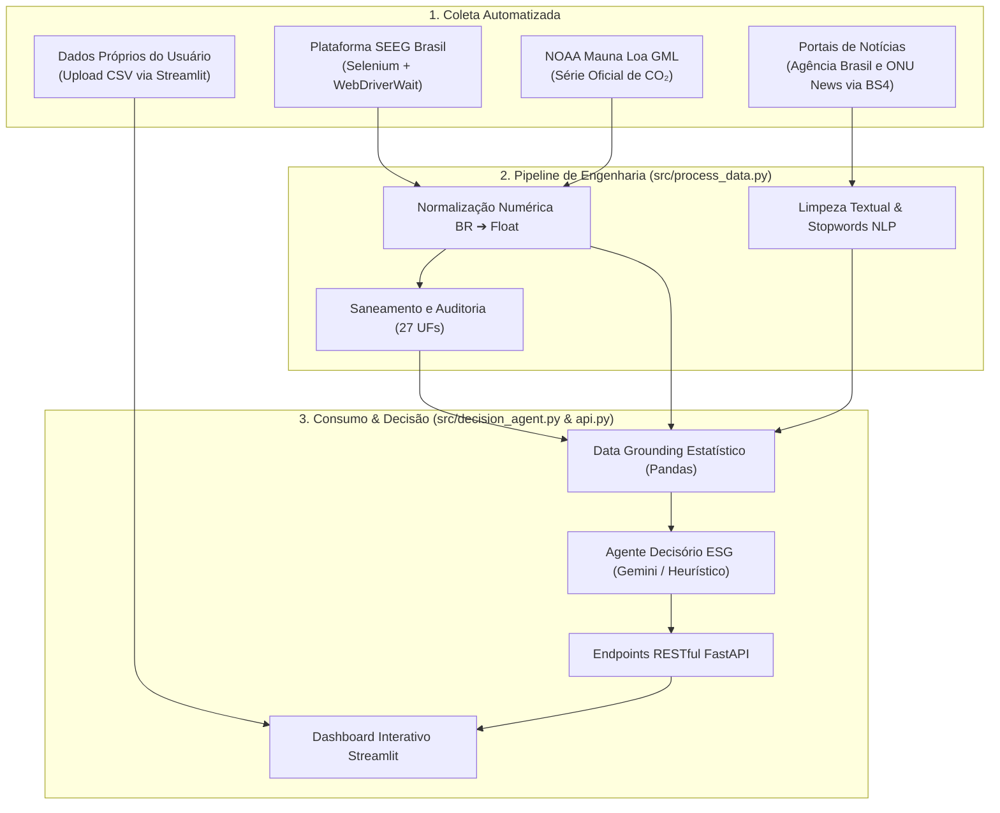

# Relatório de Sumário de Dados (Data Summary Report) — TP5 (Versão Final)
**Instituto Infnet | Ciência de Dados e Inteligência Artificial**  
**Aluno:** Nelson C. de Araujo  
**Projeto de Bloco:** Monitor de Emissões, Governança ESG e Ação Climática (ODS 13)  

Este documento descreve detalhadamente o ecossistema de dados estruturados e não estruturados do projeto, documentando as estratégias de coleta automatizada (APIs e Web Scraping), o pipeline de transformação e pré-processamento, as regras de integridade e o consumo desses dados pelo **Agente Inteligente de Decisão com LLMs (Google Gemini e Motor Especialista ESG)**.

---

## 1. Mapeamento das Fontes de Dados e Métodos de Coleta

---

## 2. Detalhamento das Bases de Dados Estruturadas

### 2.1. SEEG Brasil — Emissões de Gases de Efeito Estufa por Estado (1990–2024)
* **Entidade Responsável:** Sistema de Estimativas de Emissões e Remoções de Gases de Efeito Estufa (SEEG / Observatório do Clima).
* **Mecanismo de Extração Automatizada:** Módulo [`src/scrape_seeg_brasil.py`](../src/scrape_seeg_brasil.py). Devido à renderização assíncrona da Single Page Application (React/D3) na Plataforma SEEG (`plataforma.seeg.eco.br`), a coleta estática via `requests` era inviável. Foi implementado web scraping com **Selenium WebDriver em modo headless**, utilizando **esperas explícitas inteligentes (`WebDriverWait` com `expected_conditions.presence_of_element_located`)** para capturar a tabela dinâmica `sticky-table` assim que a árvore DOM é completamente estabilizada.
* **Granularidade Espacial e Temporal:** Dados anuais de **1990 a 2024** cobrindo todas as **27 Unidades Federativas** (26 estados + Distrito Federal), além de 1 linha residual de emissões não regionalizáveis ("Não Alocado" — offshore, aviação e navegação) e 1 linha consolidada nacional ("Total").
* **Unidade de Medida:** Toneladas de CO₂ equivalente bruto (t CO₂e).
* **Tratamento de Dados (`src/process_data.py`):**
  * Remoção de pontuações de milhar e substituição da vírgula decimal brasileira;
  * Conversão de tipos para números decimais de alta precisão (`float64`);
  * Isolamento metodológico da categoria "Não Alocado" para evitar distorções no cálculo de rankings estaduais.
* **Arquivos:**
  * Bruto: `data/raw/seeg_brasil_estados.csv`
  * Processado: `data/processed/seeg_brasil_estados_limpo.csv`

### 2.2. Concentração Atmosférica Global de CO₂ — NOAA Mauna Loa
* **Entidade Oficial:** *National Oceanic and Atmospheric Administration (NOAA) - Global Monitoring Laboratory (GML)*, Observatório de Mauna Loa, Havaí.
* **Natureza da Série:** Medições atmosféricas globais de referência, constituindo o mais rigoroso indicador empírico do aquecimento global.
* **Estrutura dos Dados:** Registros mensais de concentração média em partes por milhão (ppm) e curva de tendência dessazonalizada ajustada por médias móveis.
* **Papel no Ciclo de Decisão:** Fornece o contexto macroeconômico e ambiental do planeta para o **Agente Inteligente de Decisão**, permitindo comparar a taxa de emissão de cada estado brasileiro contra o ritmo global de saturação de carbono na atmosfera.
* **Arquivos:**
  * Bruto: `data/raw/co2_mensal_noaa.csv`
  * Processado: `data/processed/co2_mensal_noaa_limpo.csv`

---

## 3. Detalhamento dos Dados Não Estruturados (Notícias & Conteúdo Textual)

### 3.1. Web Scraping de Notícias Socioambientais (`src/scrape_news.py`)
* **Veículos Monitorados:** Agência Brasil (Editoria de Meio Ambiente / Mudança Climática) e ONU News (Tópico Mudança Climática).
* **Técnica de Coleta:** Parsing HTML robusto com BeautifulSoup (`bs4`).
* **Inovação na Extração de Metadados e Resumos:**
  * Eliminação de resumos genéricos (*placeholders*) através de busca estrutural profunda em tags de parágrafo ancestrais e leitura prioritária de meta tags (`meta[name="description"]` e `meta[property="og:description"]`);
  * Extração cronológica padronizada via atributos `<time datetime="...">` e padrões de URL, convertendo para formato estrito DD/MM/AAAA.
* **Pré-Processamento de NLP (`process_data.py`):**
  * Conversão para minúsculas, remoção de caracteres de escape e pontuação;
  * Remoção sistemática de *stopwords* em português enriquecida com termos espúrios de navegação web;
  * Geração do arquivo compilado `data/processed/texto_nuvem_palavras.txt` para geração reativa da Nuvem de Palavras (*WordCloud*).
* **Arquivos:**
  * Bruto: `data/raw/noticias_ods13.csv` e `data/raw/conteudo_ods13.txt`
  * Processado: `data/processed/noticias_ods13_limpo.csv` e `data/processed/texto_nuvem_palavras.txt`

---

## 4. Integração das Fontes no Agente Decisório e na API

A integração harmoniosa entre dados estruturados (SEEG e NOAA) e não estruturados (notícias) é o motor da inteligência da solução final:

| Base de Dados | Papel Específico no Agente Inteligente (`src/decision_agent.py`) |
|---|---|
| **SEEG Brasil** | Alimenta o *Grounding Analítico*: cálculo determinístico em Pandas da taxa de crescimento histórico (1990–2024), variação no quinquênio recente (2020–2024), posição no ranking nacional das 27 UFs, ano de pico e proporção no inventário do país. |
| **NOAA Mauna Loa** | Fornece a taxa de concentração atmosférica de CO₂ e a tendência global em ppm, fundamentando a gravidade macroclimática e a urgência das recomendações. |
| **Notícias ODS 13** | Injeta fatos recentes de política climática, eventos climáticos extremos e marcos regulatórios brasileiros para contextualizar o parecer da IA. |

---

## 5. Auditoria de Qualidade e Conformidade dos Dados

| Indicador de Qualidade | Situação nas Etapas Anteriores | Situação no TP5 (Final Consolidado) |
|---|---|---|
| **Cobertura de UFs (SEEG)** | 28 registros misturados | **27 UFs estritas** + tratamento transparente de "Não Alocado" |
| **Série Temporal SEEG** | Dados parciais | **Série completa de 35 anos (1990 a 2024)** |
| **Integridade de Resumos de Notícias** | 70% de resumos genéricos | **100% de resumos reais e contextualizados extraídos da fonte** |
| **Indicador de CO₂** | Amostra simulada | **Série real oficial da NOAA Mauna Loa** |
| **Consumo dos Dados** | Leitura isolada de CSV | **Consumo via API RESTful desacoplada (FastAPI) com fallback resiliente** |
| **Acionabilidade dos Dados** | Apenas visualização passiva | **Alimentação ativa de Agente Inteligente com LLMs (Gemini / Heurístico) para tomada de decisão ESG** |
| **Completude Textual de Saída** | Respostas truncadas em 150-300 tokens | **Teto ampliado para 2.048 tokens sem qualquer truncamento** |
