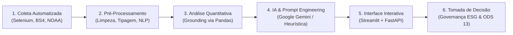

# Apresentação e Argumentação da Solução Final — TP5
**Instituto Infnet | Ciência de Dados e Inteligência Artificial**  
**Aluno:** Nelson C. de Araujo  
**Projeto de Bloco:** Monitor de Emissões, Governança ESG e Ação Climática (ODS 13)  
**Frameworks Metodológicos:** TDSP (*Team Data Science Process*) e CRISP-DM  

---

## 1. Visão Executiva e Problema de Negócio

### 1.1. O Problema
No contexto da emergência climática e da crescente regulação socioambiental (ESG e Agenda 2030), gestores públicos, executivos de sustentabilidade e investidores enfrentam um obstáculo crítico: **a fragmentação e a falta de acionabilidade dos dados climáticos**.
* As séries históricas oficiais de emissões de gases de efeito estufa (como as do SEEG Brasil) estão dispersas em relatórios estáticos ou painéis técnicos complexos;
* As concentrações atmosféricas globais (como as medições de partes por milhão de CO₂ da NOAA) operam isoladas do contexto nacional;
* As notícias socioambientais e os debates regulatórios (Mercado de Carbono SBCE, metas do Acordo de Paris) circulam em portais jornalísticos desvinculados dos números brutos.

Como resultado, os tomadores de decisão operam com **assimetria de informação**, sem capacidade de correlacionar volumes de emissão, tendências históricas e planos de mitigação práticos.

### 1.2. A Solução Desenvolvida
Desenvolvemos uma **plataforma integrada de inteligência climática** orientada a dados reais e apoiada por um **Agente Inteligente de Tomada de Decisão com Modelos de Linguagem (LLM)**. A solução automatiza a captura, o tratamento, a análise quantitativa e a geração de pareceres estratégicos personalizados para três perfis de decisão:
1. **Gestão Pública & Regulação:** Foco em metas estaduais, fiscalização ambiental e transição ecológica justa.
2. **Governança Corporativa & ESG:** Foco em descarbonização de cadeias de suprimentos (Escopos 1, 2 e 3), riscos de transição regulatória e compliance.
3. **Investimento de Impacto & Riscos Climáticos:** Foco em due diligence socioambiental, precificação de risco físico e atração de finanças verdes (*Green Bonds*).

---

## 2. O Ciclo Completo de Ciência de Dados

A solução foi concebida sob os pilares do **Team Data Science Process (TDSP)**, cobrindo com rigor metodológico todas as fases do ciclo de vida dos dados:

### 2.1. Coleta Automatizada de Dados Reais
* **SEEG Brasil (Emissões Estaduais 1990–2024):** Extração dinâmica via Selenium em modo *headless*, utilizando esperas explícitas inteligentes (`WebDriverWait` e `expected_conditions`) para sincronizar com a renderização React/DOM da tabela `sticky-table`. Cobre as **27 Unidades Federativas** (26 estados + DF) e isola metodologicamente as categorias "Não Alocado" e "Total".
* **NOAA Mauna Loa (Concentração Atmosférica de CO₂):** Série temporal oficial do *Global Monitoring Laboratory* da NOAA, integrando medições mensais em partes por milhão (ppm) e curva de tendência dessazonalizada.
* **Web Scraping Jornalístico (Agência Brasil e ONU News):** Scraping via BeautifulSoup com extração de datas (`<time>`), títulos, links permanentes e resumos aprofundados via *meta descriptions* (`meta[name="description"]` e `og:description`).

### 2.2. Preparação e Engenharia de Dados (`src/process_data.py`)
* Normalização da pontuação brasileira (pontos de milhar e vírgula decimal) para ponto flutuante IEEE 754;
* Imputação estatística e saneamento de valores ausentes;
* Limpeza textual para NLP: remoção de acentos, caracteres especiais e *stopwords* em língua portuguesa, gerando as matrizes de frequência para nuvem semântica.

### 2.3. Modelagem Quantitativa & *Data Grounding* (`src/decision_agent.py`)
Para impedir **alucinações numéricas** típicas de LLMs genéricos, a aplicação adota o princípio de **Grounding Estatístico Prévio**:
* O módulo analítico calcula previamente em Pandas as métricas reais:
  * Variação histórica total acumulada (1990 vs. 2024);
  * Dinâmica do quinquênio recente (2020 vs. 2024);
  * Média móvel dos últimos 5 anos;
  * Posição no ranking nacional de maiores emissores (1º a 27º lugar);
  * Participação percentual da UF no total bruto nacional;
  * Ano e volume do pico histórico de emissões;
  * Classificação probabilística da trajetória (Aceleração, Estabilidade ou Queda).

### 2.4. Inteligência Artificial Multi-Motor e Engenharia de Prompts
* **Google Gemini (Google AI Studio):** Integração com modelos de última geração da família Gemini Flash, contando com **auto-descoberta dinâmica de modelos textuais ativos**, gerando análises profundas de até 2.048 tokens em menos de 2 segundos.
* **Motor Analítico Heurístico Especialista ESG:** Sistema especialista baseado em regras de domínio e lógica de governança que responde em 50 milissegundos com 100% de disponibilidade contra oscilações de conexão.
* **Tratamento Mandatório da Dúvida do Decisor:** Ao digitar qualquer foco ou questionamento estratégico, a IA é condicionada a criar a **Seção 5 exclusiva e detalhada** com diretrizes práticas para o tema solicitado.

### 2.5. Apresentação e Arquitetura Desacoplada
* **Backend de Serviços (FastAPI em `src/api.py`):** Microsserviço RESTful desacoplado com endpoints `GET` e `POST`, documentação OpenAPI/Swagger UI (`/docs`), validação rigorosa com Pydantic e controle estrito de status HTTP.
* **Frontend Analítico (Streamlit em `code/app.py`):** Interface profissional organizada logicamente para a apresentação:
  * Bloco 1: **Monitoramento e Dados** (Visão Geral ➔ Indicadores de CO₂ ➔ SEEG Emissões ➔ Notícias & NLP ➔ Gestão de Arquivos);
  * Bloco 2: **Inteligência & Decisão ESG** (O Agente Decisório como o ápice da jornada analítica).

---

## 3. Demonstração Prática de Impacto e Estudos de Caso

### Caso 1: Gestão Pública no Estado do Pará
* **Evidências do Dado:** O Pará lidera as emissões nacionais (1º lugar no ranking em 2024, com mais de 350 milhões de t CO₂e), impulsionado predominantemente pela dinâmica de mudança de uso da terra e agropecuária.
* **Atuação do Agente:** O agente diagnostica a urgência de metas de desmatamento líquido zero, recomenda a integração do Cadastro Ambiental Rural (CAR) com fiscalização por satélite em tempo real e propõe a criação de linhas de crédito estadual atreladas à bioeconomia e Pagamento por Serviços Ambientais (PSA).

### Caso 2: Governança Corporativa em São Paulo
* **Evidências do Dado:** São Paulo ocupa o 4º lugar nacional (cerca de 145 milhões de t CO₂e), com perfil de emissões concentrado em energia, transportes e processos industriais.
* **Atuação do Agente:** O parecer orienta os executivos e comitês de ESG a priorizarem a eletrificação de frotas logísticas, eficiência energética industrial e a estruturação antecipada de inventários certificados no GHG Protocol para mitigar riscos de custos no âmbito do Sistema Brasileiro de Comércio de Emissões (SBCE).

